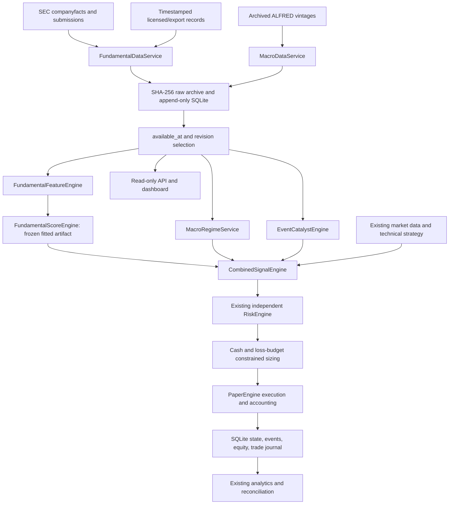

# Point-in-time fundamental layer — research and verification

> Superseded in part by [the independent QA audit](fundamental-qa-audit.md). That audit found and repaired PIT, unit and accounting defects; this document preserves the earlier experiment rather than certifying all capabilities.

Research date: 30 September 2026. **No incremental, deployable edge has been established.** The implemented layer can ingest, version, calculate, explain and paper-test fundamental observations. The corporate-factor performance question remains unresolved because the existing trading universe consists mainly of ETFs and crypto, and this repository has no complete historical ETF constituent dataset. No current holdings or current financial website values were substituted for historical data.

## Result and scope

The existing XLE Bollinger candidate finished the 366-session diagnostic interval with **£100.01880867** from £100, eight trades, Sharpe **0.01776959**, maximum drawdown **1.49251010%**, and net profit factor **1.01260204**. The tested macro and joint filters produced exactly the same XLE trades. They added **£0** to that result. Doubling commissions and slippage changed ending equity to **£99.755581** for both technical and macro variants.

Across six ETFs, some macro filters helped and others hurt. Every nonzero paired block-bootstrap incremental interval included zero. This is insufficient evidence to change deployment. The history was used in previous strategy research: the final chronological segment is a **temporal diagnostic holdout, not pristine out-of-sample evidence**. Fundamental observation-only parity is a plumbing check, not a corporate-factor ablation.

Recommended configuration: fundamentals **observe only**, no fitted model approved, original evidence gate **NO_TRADE**, `TRADING_MODE=PAPER`. Neither a high fundamental score nor the £1,000 objective changes risk limits. Real-money trading remains unqualified.

## Existing architecture and integration

The audit covered the Python project’s data ingestion, strategy/rule research, event-driven and vectorized backtests, simulation, risk/position sizing, SQLite/Parquet storage, analytics/Monte Carlo, Streamlit dashboard, CLI tools, tests and broker adapters. The small-account path has the strongest audited deterministic accounting and was extended rather than replaced. Legacy Alpaca execution remains separate; its partial-fill defect is a strict expected failure in the test suite.



Source of truth for cash, equity, positions, fees and realized P&L remains `livesim/small_account.py` and its transactional paper ledger. Fundamentals never mutate those balances. The new decision is evaluated before entry, then the existing central risk engine validates every candidate. `FUNDAMENTAL_DECISION` records include features, provenance, model, macro state, catalysts, explanations, risk outcome and approved size. Reducing exits retain the existing execution path. Without an optional filter, previous paper configuration and behavior are preserved.

The public paper CLI now accepts a fundamental database and `observe`/`filter` policy. Unapproved `filter` fails closed. Research influence requires an explicit research-shadow object and cannot authorize live execution. The loopback HTTP service exposes no order or mutation endpoint.

## Data sources researched

Provider statements below were checked against primary documentation on the research date. “Historical” alone does not establish historical availability or full restatement vintages. Paid products were researched, not purchased or empirically certified. Exact licensed prices, depth by security and contractual limits remain unverified where providers require a quote.

| Provider | Coverage, history and access | PIT/cost decision |
|---|---|---|
| [SEC APIs](https://www.sec.gov/search-filings/edgar-application-programming-interfaces) | Free public US filings; accession-tagged structured financial facts and submission metadata; issuer/tag coverage varies | Implemented. Original accession retained; receipt and publication clocks kept separate. Set an honest `SEC_USER_AGENT`; cached, rate-conscious requests. Companyfacts is not a universal original-vintage database. |
| [ALFRED](https://fred.stlouisfed.org/docs/api/fred/realtime_period.html) | Public macro vintage histories; ordinary current FRED defaults are unsuitable for historical knowledge | Implemented actual vintage CSV snapshots, not a latest series with an invented lag. |
| [Bank of England GDP real-time database](https://www.bankofengland.co.uk/statistics/gdp-real-time-database) | UK GDP vintages | Useful next UK macro source; not ingested in this experiment. |
| [Companies House](https://www.gov.uk/government/organisations/companies-house/about/about-our-services) | UK company filings | Annual legal accounts are not a substitute for timely listed-company quarterly consensus. Export adapter available; no invented UK quarterly coverage. |
| [Financial Modeling Prep](https://site.financialmodelingprep.com/faqs) | Free tier advertises 250 requests/day and limited annual US history; broader/international access by plan | International filing dates may be mapped to report dates when SEC dates do not exist. Do not treat such a field as historical publication proof. No authenticated extraction. |
| [Alpha Vantage](https://www.alphavantage.co/support/) | Standard free allowance 25 requests/day; paid/eligible verified-project exceptions | Suitable for limited exploration; original-vintage retention must be independently established. No keys used. |
| [Massive, formerly Polygon](https://massive.com/knowledge-base/article/does-massive-provide-the-filing-date-for-any-financial-reports) | New financial endpoints expose filing dates; [API migration](https://www.massive.com/changelog) replaces the experimental endpoint | Filing date helps, but current ratio histories are not proof of original-as-known statement versions. No paid access tested. |
| [Tiingo](https://www.tiingo.com/documentation/fundamentals) | Fundamental API; [fundamental pricing](https://app.tiingo.com/pricing/) requires plan/add-on evaluation | Historical depth is not enough to establish vintage correctness. No license or full archive obtained. |
| [Intrinio](https://data.intrinio.com/documentation/web_api/get_fundamental_reported_financials_v2) | Reported financials by filing/fundamental; commercial datasets | Promising accession/period handling; licensed inactive coverage and original versions require sample validation. |
| [Nasdaq Data Link / Sharadar SF1](https://data.nasdaq.com/databases/SF1/documentation?anchor=see-also) | Commercial structured fundamentals | Evaluate as-reported versus most-recent dimensions and date-key semantics before use. No dataset imported. |
| [FactSet](https://insight.factset.com/hubfs/Resources%20Section/White%20Papers/ID11996_point_in_time.pdf) | Institutional PIT estimate products and historical fundamentals | Strong candidate if a license already exists. Post-event consensus windows must never be treated as pre-event estimates. Quote required. |
| [Bloomberg](https://professional.content.cirrus.bloomberg.com/professional2023/insights/webinar/index-level-fundamental-analysis-using-bql/) | Licensed fundamental and constituent research | Not cost-justified solely for a £100 experiment; no licensed endpoint tested. |
| [LSEG I/B/E/S](https://www.lseg.com/en/data-analytics/financial-data/company-data/ibes-estimates) | Historical aggregate estimates; institutional access | Candidate for revisions/surprises once timestamped entitlement exists; no current consensus backfilled. |
| [Morningstar financial statements API](https://advisor.morningstar.com/Enterprise/VTC/EquityData/EquityDataFinancialStatementsGuidanceAPI.pdf) | Distinct original, preliminary, restated and TTM report types; industry-specific packages | Potentially suitable, but “most recently restated” is not a full historical vintage query. Select original versions and verify timing. Licensed access not available here. |
| [Coin Metrics](https://docs.coinmetrics.io/api/v4/) | Community network API and paid services; reviewed/revised metric states | Appropriate crypto source family. Observation and revision timing must be archived; no retrospective network data passed off as known-in-real-time. |

The actual archive contains **80 distinct raw documents, 6,761 observations and 134 filing events**: one company (XOM) plus 78 ALFRED snapshots (CPIAUCSL, UNRATE, FEDFUNDS; quarterly vintages April 2020–July 2026). All 78 snapshot downloads succeeded. This is a demonstrator of statement ingestion and a real macro dataset, not a complete investable equity universe. Paid costs incurred: zero.

The [official XLE N-PORT index](https://www.sec.gov/Archives/edgar/data/1064641/0001752724-21-043939-index.htm) distinguishes a December 2020 portfolio from its February 2021 filing. Bulk archive requests returned HTTP 403 in this environment. No complete dated holdings history was obtained. XOM was **not** used as a proxy for the whole XLE portfolio.

## Point-in-time database and leakage controls

Each financial observation stores `symbol, metric, value, period_start, period_end, reported_at, available_at, observed_at, source, revision, currency, units, kind, metadata`. Raw bodies are content-addressed. FinancialStatements, MacroSeries, EstimateRevisions and InsiderTransactions are typed views over immutable observations; CorporateEvents is a separate versioned table. Feature snapshots, model artifacts and decisions are stored separately. UPDATE/DELETE triggers preserve append-only provenance.

Queries select only versions with `available_at <= decision time`; restatements become visible only after their own publication. `observed_only=True` additionally enforces local first-seen time. Corporate research reconstructs public availability, whereas first-seen operational replay is deliberately stricter. Duplicate ingestion does not invent a new economic revision. Conflicting equally-timed source values fail instead of silently selecting one. A missing/withdrawn fact remains null.

SEC exact acceptance timestamps receive a conservative five-minute processing delay. Where recent submissions do not contain an accession’s acceptance time, availability is the following New York calendar day after the recorded filing date. That rule is conservative and can miss earlier press-release information. The data does not claim to capture every original filing context. Current companyfacts may omit contexts; a few official cross-checks cannot certify the entire historical archive.

ALFRED snapshots become available on the following UTC day. Their header must exactly match the requested series and vintage. These are quarterly historical information snapshots, **not exact macro release timestamps**. Thus the model intentionally uses a delayed, coarse information set. Latest-value FRED data is never backdated.

Effective dates also constrain classification and holdings records. Original currencies are retained; FX conversion requires a contemporaneously available quote with matching units and a freshness check. Split events must be both known and effective, and price/share adjustment bases must match. Missing ETF constituents invalidate the metric; covered survivors are not reweighted to 100%.

The existing daily price timestamps are session-date labels at midnight New York, not exact auction timestamps. Research decisions use this conservative information cutoff and the following modeled session open; no claim of sub-minute earnings execution is made. Price adjustment conventions, distributions, historical tradability and GBP/USD exposure remain limitations of the pre-existing price experiment.

## Features and economic interpretation

The machine-readable [feature dictionary](fundamental-feature-dictionary.json) documents 35 raw metrics and 62 accounting/growth/health features: formulas, source, historical availability, timestamp rule, normalization, missing behavior, rationale, evidence category and testing method. **Every local predictive-usefulness field is NOT_ESTABLISHED; production weights are null.** Deterministic correctness is distinct from predictive validation.

| Group | Examples and definitions | Handling |
|---|---|---|
| Growth | `(current/prior)-1`; acceleration is the difference between comparable growth rates; 3-/5-year revenue CAGR | Nonpositive baseline returns null rather than a misleading growth percent; annual periods aligned; discrete quarter flows use direct facts or YTD differences. |
| Profitability | Margins; ROE/ROA on average balances; ROIC from operating income after estimated tax / average debt+equity−cash | Tax must be in [0,1]; EBITDA is explicitly an operating-income-plus-D&A proxy. |
| Health | Current and quick ratios, total/net debt, debt/equity, coverage and cash/debt | Both current and noncurrent debt are needed. Short-term borrowings alone are not a substitute for all current debt. Missing prepaids are not zero. |
| Earnings quality | OCF/net income, FCF/net income, cash-flow accrual proxy, receivables/inventory growth minus sales growth | Descriptive accounting proxies, not fraud labels. Consolidation scope must be checked; XOM’s attributable income and consolidated OCF differ in scope. |
| Capital allocation/efficiency | Diluted share growth, reinvestment, incremental ROIC, cash conversion cycle, R&D and distribution ratios | Sector restrictions apply; differing cash-flow definitions remain explicit. |
| Valuation | P/E, forward P/E, P/S, P/B, EV/revenue, EV/EBITDA, price/FCF, yields | Standalone tested transforms. No live valuation series without aligned price/share currency and split basis. Missing preferred/minority claims prevent EV. PEG and forward-estimate histories are not populated. |
| Relative comparisons | PIT sector percentile; winsorized cross-sectional z-score; own 3-/5-year percentile | Minimum sample required; all contemporaneous membership/classification data must be supplied. No current-sector backfill. |
| Revisions/events | Fixed forecast fiscal-target changes over 30/60/90 days; `(actual-consensus)/abs(consensus)` | Consensus must precede event; no reliable estimate archive means missing, not zero surprise. |

Sector adapters cover banks, SaaS, retail, semiconductors and energy, with metrics such as CET1/NPL, ARR/LTV:CAC, stores, inventory and production unit margin. These require explicit sector inputs; they are not filled with irrelevant equity ratios. Crypto has a separate network/supply/funding transform, forex uses macro, and ETFs require dated holdings. Those provider-specific feeds are interfaces, not claims of populated historical coverage.

The original manufacturing Altman discriminant is available as a descriptive research helper, not a calibrated trading threshold. No subjective moat label, fraud classification or arbitrary distress score is generated. News annotations must cite exact spans in archived source documents, distinguish social/news, preserve publication and first-seen time, and carry no execution authority. Earnings-call NLP, automatic news gathering, licensed analyst consensus and insider-feed normalization remain unimplemented data acquisitions; structured export contracts are available.

## Evidence review

Academic evidence motivates experiments; it does not prove an edge in this account or horizon.

| Family | Primary evidence | Counterweight and local disposition |
|---|---|---|
| Value and momentum | [Asness, Moskowitz and Pedersen](https://www.aqr.com/insights/research/journal-article/value-and-momentum-everywhere) studies joint patterns across markets | Long/short diversified institutional portfolios do not translate directly to £100 swing trades. No local corporate test completed. |
| Gross profitability | [Novy-Marx](https://www.nber.org/papers/w15940) documents gross-profitability effects | Not evidence for minute-level entries; accounting definitions and microcaps matter. [Later profitability research](https://www.nber.org/papers/w33601) is context, not permission to assume persistence. |
| Quality | [Quality Minus Junk](https://www.aqr.com/Insights/Research/Working-Paper/Quality-Minus-Junk) combines profitable, growing, safer businesses | Academic/practitioner overlap is disclosed. Do not import institutional factor weights into this universe. |
| Investment/profitability/size | [Fama and French, Dissecting Anomalies](https://papers.ssrn.com/sol3/papers.cfm?abstract_id=911960) examines characteristic effects | Weak or heterogeneous results by size/universe warn against a universal quality score. |
| Accruals | Sloan (1996), *Do Stock Prices Fully Reflect Information in Accruals and Cash Flows about Future Earnings?*, is the original hypothesis behind this research feature | No direct original-paper replication or modern net-cost test completed here. Cash-flow accrual proxy is not a replication of every original balance-sheet definition. |
| PEAD | [Recent NBER work](https://www.nber.org/papers/w34086) studies retail behavior around announcements | [2026 preprint](https://arxiv.org/abs/2601.08962) questions exploitable timing as adjustment accelerates. Preprint status matters. No pre-event consensus feed means no valid local PEAD test. |
| Analyst revisions | Timestamped consensus revisions provide a testable expectations channel | Provider capability is not evidence of profitable signals. Local historical estimates unavailable; no claim of current persistence. |
| Costs and replication | [Novy-Marx and Velikov](https://www.nber.org/papers/w20721) evaluates anomaly implementation costs; [Replicating Anomalies](https://www.nber.org/system/files/working_papers/w23394/w23394.pdf) challenges broad anomaly robustness | Turnover and multiple testing can erase apparent returns. These objections drive the frozen-cost ablations and deployment refusal. |

No internet anecdote or social-media claim was used as proof. Profitability, revisions and catalysts are plausible candidate-selection inputs over weeks/months. Whether they help this particular short-horizon system remains an empirical question.

## Models and fusion rules

`FundamentalScoreEngine` returns null/UNVALIDATED without an artifact. It never creates a 0–100 number from arbitrary weights. Research models use training-only standardization and ridge coefficients fit to future net returns; labels must have matured before the simulated fitting clock. Artifacts store means/scales, coefficients, intercept, alpha, horizon, training cutoff and training-data SHA. A score is a predicted return, **not a success probability**. Completeness is shown separately and no calibrated confidence is invented. Artifacts cannot self-approve deployment.

The macro engine uses CPI year-over-year and its three-month change, unemployment changes, and policy-rate changes. “Rising/falling” means the literal sign of a change, not an invented Goldilocks label. Vintage age limit 100 days is an operational research freshness rule, not an optimized alpha threshold. No macro exposure multiplier is approved.

A/Filter requires technical entry plus positive fitted expected net return. B/Selection waits for the same technical entry after model qualification; with one asset and one position this is equivalent to A, not a separately claimed result. C/Joint fits macro and the technical indicator together. D adds a complete/fresh macro-data requirement to that joint model. No arbitrary fundamental/technical blend weights are exposed as production alpha. Corporate variants cannot be estimated without the required input panel. Catalysts remain descriptive; a supplied decay half-life is research-only, not empirically approved.

No trade is produced on missing required features, stale data, unsupported instrument mapping or unapproved influence. Fundamental flags are visible but do not silently tighten/loosen risk based on untested assumptions.

## Reproducible historical experiment

Price data: SPY, XLE, XLF, XLK, XLP, XLV, 1,464 sessions, 27 July 2020–22 May 2026. First 50% trains; next 25% validates; final 25% diagnoses. Training cutoff is 23 June 2023; diagnostic starts 5 December 2024. Target horizon five sessions; ridge alpha chosen from 0.1/1/10/100 on validation MSE only. Labels ending on/after the training/validation cutoff are purged. Feature IC is also evaluated at 1/5/20/60/120 sessions. Overlapping targets are not given IID significance claims.

Every variant shares Bollinger-20 rules, original risk limits, next-bar-open execution, stop/target rules and accounting. The common baseline is 15bp per side for fee/FX proxy, 2bp full spread and 3bp per-side slippage. The label cost hurdle is 38bp per round trip. These are explicit modeling assumptions, not verified executable GBP broker quotes. Cost stress doubles fees and slippage while holding spread fixed.

| ETF | Technical ending £ | Macro-filter ending £ | Increment £ | Technical trades | Macro trades |
|---|---:|---:|---:|---:|---:|
| SPY | 98.513615 | 99.105825 | +0.592210 | 13 | 5 |
| XLE | 100.018809 | 100.018809 | 0 | 8 | 8 |
| XLF | 101.694840 | 101.929611 | +0.234771 | 11 | 9 |
| XLK | 99.875167 | 99.168857 | −0.706310 | 11 | 4 |
| XLP | 101.940287 | 100.000000 | −1.940287 | 10 | 0 |
| XLV | 100.902752 | 100.000000 | −0.902752 | 8 | 0 |

Observation-only and fitted joint variants matched their technical baselines in this experiment. Full returns, annualized statistics, fees, turnover, exposure, trade outcomes, drawdowns and ICs are in `results/fundamentals/experiment/`. Annualization is 252 observed returns/year, explicitly not elapsed-calendar CAGR. The 10,000-path paired 20-session-block SPY incremental interval was [−£1.9612, +£3.4722]; XLF [−£0.3919, +£1.0989]. Nonzero intervals for the other ETFs also spanned zero. These are conditional descriptive intervals, not multiple-testing-adjusted evidence.

| System on XLE | Diagnostic return | Sharpe | Max drawdown | Profit factor | £1 ruin bootstrap |
|---|---:|---:|---:|---:|---:|
| Technical | +0.018809% | 0.017770 | 1.492510% | 1.012602 | 0/100,000 |
| Technical + corporate fundamentals | Not estimable | — | — | — | Not estimable |
| Technical + macro filter | +0.018809% | 0.017770 | 1.492510% | 1.012602 | 0/100,000 |
| Technical + corporate fundamentals + macro | Not estimable | — | — | — | Not estimable |

Cross-sectional decile/IC tooling rejects future universe membership and requires at least 20 names. It was tested on deterministic data, not misrepresented as a six-ETF corporate-factor result. No SHAP/permutation finding, sector rotation edge, calibrated earnings policy or fundamental feature importance is claimed without appropriate data.

## £100 experiment

Each of five XLE configurations ran **100,000 paths**, 21 simulated sessions as an approximate 30-calendar-day equity horizon, five-session circular blocks, seed 1941. Returns already include the replay’s costs. All configurations had the same source curve:

| Quantity | Conditional bootstrap result |
|---|---:|
| Median ending equity | £100.000000 |
| Mean ending equity | £100.000653 |
| Mean maximum drawdown | 0.147667% |
| 95th percentile maximum drawdown | 0.656976% |
| End at or above £100 | 74.478% |
| End at/below £50 | 0/100,000 |
| Hit £200 / £500 / £1,000 | 0 / 0 / 0 out of 100,000 |
| Exact zero / below £1 at any point | 0 / 0 out of 100,000 |

These are **not credible unconditional ruin forecasts**: eight trades and many flat days cannot represent unobserved crashes, gaps, structural breaks or broker failure. Zero observed events has a binomial one-sided 95% upper bound of about 0.003% *under this fixed simulation model only*. The sparse empirical support cannot establish that real-world ruin is that rare. The extra layer did not improve this experiment. £100→£1,000 still requires 900% total return, which is approximately 7.98% compounded PER CALENDAR DAY over 30 days (11.59% per session over 21 sessions; a total of 7.98% over 30 days would reach only £107.98). Fundamentals do not make that target plausible here.

## Verification and defects fixed

Full suite: **501 passed, 1 strict expected failure, 5 warnings** in 102.58 seconds. The expected failure is the pre-existing legacy Alpaca partial-fill defect. The warnings are a deprecated websocket import and undefined correlations in constant-return tearsheet fixtures; neither is silently reported as a fundamental-factor success.

The new tests cover release-date exclusion, later restatements, null withdrawal, duplicate/atomic ingestion, source conflicts, UTC timing, actual ALFRED vintage headers, direct/YTD quarter calculation, accounting formulas, sector normalization, missing data, currency/split checks, matured labels, frozen normalization, deterministic scores, risk rejection, paper execution/exit, API endpoints and browser numbers. A separate 100,000-path matrix/cumulative-product oracle verifies Monte Carlo means, medians, drawdowns, event counts and reproducibility independently of the production loop.

Real Chrome/Playwright opened the research page, verified revenue growth **20.00%**, gross margin **40.00%**, FCF **12.00**, and exported JSON. Changing the cutoff to before publication changed growth to **11.11%**, FCF to **10.00**, and excluded the future report. Source DB, API and downloaded UI values reconciled. Browser traces and screenshots are saved in `results/fundamentals/browser/`. A separate real-data Chrome run verified XOM revenue growth −16.70%, FCF 33,450,000,000.00, the Unvalidated score and downloaded JSON against the official-source arithmetic; see `real_xom_verification.json` and `real_xom.png`.

The deterministic full chain ingested statements, calculated features, applied a fitted synthetic research model, combined the technical signal, passed the real RiskEngine, entered the real paper portfolio and exited to independently expected **£101**. This tests execution plumbing; synthetic labels are not predictive evidence. A public Kraken quote was also passed through the paper CLI: **HOLD, £100 cash/equity, no position**, with observed spread and venue minimum. No live order or real fund was used.

Six official XOM checks match the API: 2023 attributable income $36.010bn, operating cash flow $55.369bn, PP&E purchases $21.919bn, assets $376.317bn, diluted EPS $8.89 and independently calculated OCF-minus-PP&E FCF $33.450bn. The company’s $36.095bn non-GAAP FCF uses a different definition. [Official release](https://corporate.exxonmobil.com/news/news-releases/2024/0202_exxonmobil-announces-2023-results). See `official_filing_reconciliation.json` for expected, actual and difference.

Repairs made during validation: enforce FX currency/unit direction; reject mixed-currency insider aggregation; preserve missing insider data instead of zero activity; reject incompatible historical percentile sources; reject equally-timed conflicting facts; validate simulation dimensions/counts; avoid mixing basic/diluted EPS and incomplete debt tag fallbacks; reject missing/negative ETF weights and FX quotes whose underlying observation is stale despite recent publication. These are data correctness fixes, not strategy redesign.

| Verification | Result and boundary |
|---|---|
| Fundamental arithmetic | PASS for implemented deterministic formulas and six official sample checks |
| PIT/revision exclusion | PASS in tested ingestion, feature, API and browser paths |
| Look-ahead not detected | PASS for tested publication/vintage/model boundaries; not universal archive certification |
| Risk-engine integration | PASS; no model can self-approve real trading |
| Paper entry/exit/accounting | PASS deterministic full-chain fixture |
| API/UI numerical reconciliation | PASS deterministic published/before-publication fixture |
| Monte Carlo implementation | PASS 100,000-path independent reconstruction |
| Existing regression suite | 501 PASS; one known legacy execution XFAIL |
| Corporate OOS incremental value | UNRESOLVED: missing dated universe/holdings/coverage |
| Macro incremental value | NOT ESTABLISHED; reused holdout, mixed outcomes, zero XLE increment |
| Real-money deployment | NOT APPROVED |

## Files and running the system

New modules: `fundamentals/store.py`, `providers.py`, `services.py`, `features.py`, `dictionary.py`, `adapters.py`, `models.py`, `catalysts.py`, `research.py`, `api.py`. New CLIs: `examples/ingest_fundamentals.py`, `ingest_fundamental_history.py`, `research_fundamentals.py`, `stress_fundamentals.py`, `verify_fundamental_data.py`, `serve_fundamentals.py`. New UI: `dashboard/fundamentals_app.py`, `dashboard/views/fundamentals.py`. Modified integration points: `livesim/small_account.py`, `examples/paper_small_account.py`, `dashboard/app.py`. Regression tests: `tests/test_fundamentals.py`, `tests/e2e/test_fundamentals_browser.py`. Existing unrelated working-tree changes were preserved.

From the repository root:

```bash
# Free raw/vintage cache and accession-aware company sample. Set SEC_USER_AGENT
# to your genuine identifying application/contact before uncached SEC requests.
.venv/bin/python examples/ingest_fundamental_history.py --include-xom
.venv/bin/python examples/research_fundamentals.py
.venv/bin/python examples/stress_fundamentals.py
.venv/bin/python examples/verify_fundamental_data.py

# Loopback read-only API and research UI in separate terminals
.venv/bin/python examples/serve_fundamentals.py
.venv/bin/streamlit run dashboard/fundamentals_app.py --server.address 127.0.0.1

# Public quotes into local PAPER; no model approved and no real order route
TRADING_MODE=PAPER .venv/bin/python examples/paper_small_account.py --once \
  --database results/fundamentals/paper-new.sqlite \
  --fundamental-database results/fundamentals/fundamentals.sqlite \
  --fundamental-policy observe

.venv/bin/pytest -q
```

Raw fetches reuse their cache for reproducibility. To collect new company filings, run `ingest_fundamentals.py --symbol XOM --cik 34088 --cache results/fundamentals/raw-YYYYMMDD` with a new dated cache directory and the existing database. The old bodies and economic versions remain archived. This is an explicit ingestion job, not an installed recurring scheduler.

HTTP endpoints: `/fundamentals/{symbol}`, `/history`, `/score`, `/events`; `/macro/regime`; `/watchlist/fundamental`; `/strategies/{strategy}/explanation`. Historical queries use `?as_of=2024-06-01T00:00:00Z`; instrument queries accept `asset_class`. Watchlist values stay unranked when no validated model exists. JSON exports retain source lineage. Append-only research artifacts store all model choices; there is no automatic retraining or deployment.

## Remaining work, ranked by evidence value

1. Obtain an original-as-known equity universe including inactive names, delisting returns, historical classifications, split-consistent prices and dated ETF holdings. This is the principal blocker to the requested corporate comparison, not missing score weights.
2. Freeze a future evaluation window and collect timestamped prospective paper observations before examining outcomes. Eight diagnostic trades cannot justify deployment.
3. Build a broad, purged corporate panel and run value/quality/profitability/accrual/growth ablations at 1/5/20/60/120 sessions with realistic fractional-order and GBP execution costs. Compare simpler filters first; report cost- and multiple-testing-adjusted uncertainty.
4. Obtain pre-event consensus vintages and reliable release clocks before PEAD/revision/news-decay experiments. Distinguish publication from local ingestion and compare several explicitly prespecified horizons.
5. Expand macro vintages and UK coverage, sector-specific metrics, official earnings calendars, ETF flows and crypto-native archives only where incremental tests warrant the extra data cost.
6. Qualify the independent legacy execution/reconciliation defects before any real-money route. Passing these fundamental tests is not a live-trading safety certificate.

The quantitative answer today is: **adding the tested macro information did not improve the leading XLE candidate, and the available data cannot establish whether company fundamentals improve this trading system out of sample after costs.** The implementation makes that question testable without manufacturing the missing evidence.
