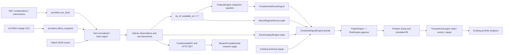

> Current: [independent re-audit, 1 October 2026](fundamental-reaudit-2026-10-01.md) (supersedes the verdicts below where they differ).
>
> Follow-up: [capability implementations and closure verification](fundamental-audit-closure.md). This document preserves the original audit findings; the follow-up records subsequent repairs and their exact scope.

# Independent fundamental-system QA audit

Audit date: 30 September 2026. This report supersedes the software-correctness conclusions in the earlier implementation report. The existing outputs were treated as claims to reproduce, not as expected answers.

**Verdict:** the tested equity-accounting, publication-time, fitted-model and risk-gated paper paths pass after repairs. The full proposed fundamental platform is not complete: TTM, calibrated confidence, semantic news extraction, complete historical universes and several live data feeds are absent. No predictive edge or real-money readiness is established.

## Architecture actually traced

The executable path is:



The CLI ingestion paths call the provider/store functions directly. The service facades in `fundamentals/services.py` are convenience wrappers, not an additional independent database or accounting engine. Corporate features are annual statement ratios plus selected discrete-quarter changes; this is **not a TTM engine**. ETF constituent aggregation, sector-specific transforms, FX, revisions and valuation have standalone helpers. Not all are wired into the default company snapshot. The default dashboard/API has no approved scoring artifact and correctly displays Unvalidated/null.

Historical research is `examples/research_fundamentals.py` → `fundamentals/research.py` → the same `livesim/small_account.py` used for paper execution. No broker-order endpoint exists in the new fundamental API. Legacy execution adapters remain separate and are not certified by this audit.

### Sources of truth

| Field/data | Stored source | Transformation and consumers |
|---|---|---|
| Raw statements | `raw_documents` SHA-256/body; cached SEC JSON | Immutable original input for provider reconstruction; never overwrite raw evidence |
| Normalized metric | `observations.value`, currency, units, period_start/end | Explicit scaling; feature calculations consume available versions |
| Fiscal period | XBRL start/end | Annual duration matching or direct/additive quarter reconstruction; not a publication clock |
| Filing/publication | Accession filing date; submissions acceptance where present | Exact acceptance + five minutes; otherwise following New York calendar day |
| Historical availability | `observations.available_at` | SQL cutoff in all audited financial queries |
| Local receipt | `observed_at` | Optional operational `observed_only` cutoff; distinct from reconstructed public availability |
| Revisions | Source/accession and immutable observation IDs | Latest unambiguous known revision; no retroactive overwrite |
| Currency/scale | Source units; normalized value with original scale metadata | GBP/USD/EUR/JPY deterministic scale tests; FX uses historical known quote and direction checks |
| Shares/EPS | Accession facts and explicit `share_basis` when supplied | Per-share growth unavailable without verified common basis; a generic `as_reported` marker is insufficient |
| Sector/industry | Dated classification observations and metadata | Publication/effective dates; no current sector backfill. No complete industry history is populated |
| Estimates/insiders | Provider-neutral typed observations | Fixed forecast period and filing-availability filtering; no licensed production archive present |
| Macro | Actual ALFRED vintage snapshots | Following-UTC-day availability; original vintages, not current revised FRED |
| Events | Versioned `corporate_events`, publication/available/event times | Upcoming announced event may have future effective time; results/estimates require valid publication inputs |
| News | Archived document, exact evidence span and ingestion/publication clocks | Structured annotations only; no implemented semantic extractor |
| Decisions | Paper event journal plus configuration, model specification, snapshot hash and source IDs | Deterministic reconstruction; central risk engine still owns approval and size |

Combined financial/macro/event evaluation now holds one SQLite read transaction. A concurrent-writer test confirms the first evaluation sees one old snapshot and the next sees the new data, rather than a mixture.

## Independent oracle and golden companies

`tests/fundamental_oracle.py` imports **no production calculation modules**. It uses Decimal and standard-library statistics for accounting, valuation, ranking, fitted linear scores, returns, drawdowns, Sharpe, Sortino, profit factor, expectancy, win rate, fees and turnover. Production functions are called only by the comparison harness.

`tests/fixtures/fundamental_companies.json` permanently defines ten companies: the supplied golden example, high/low growth, loss-making, high debt, cash-rich, distressed, diluted, improving and deteriorating. There are **390 independently reconciled formula values**. Missing/nonpositive denominators follow the documented null convention; negative earnings are not ranked as positive cheap P/E.

Golden-company values below use millions for like-for-like arithmetic. The ingestion/browser fixture separately scales monetary amounts to actual GBP units.

| Metric | Independent expected | Actual | Difference | Result |
|---|---:|---:|---:|---|
| Revenue growth | 0.20 | 0.20 | within 1e-12 | PASS |
| FCF | 20 | 20 | 0 | PASS |
| Gross margin | 0.50 | 0.50 | 0 | PASS |
| Operating margin | 0.20 | 0.20 | 0 | PASS |
| Net margin | 0.15 | 0.15 | 0 | PASS |
| FCF margin | 0.1666666667 | 0.1666666667 | within 1e-12 | PASS |
| ROE, average equity | 18 / 85 = 0.2117647059 | 0.2117647059 | within 1e-12 | PASS |
| ROA, average assets | 18 / 140 = 0.1285714286 | 0.1285714286 | within 1e-12 | PASS |
| ROIC | 18 / 75 = 0.24 | 0.24 | 0 | PASS |
| Current ratio | 2 | 2 | 0 | PASS |
| Quick ratio | (50−10−2)/25 = 1.52 | 1.52 | 0 | PASS |
| Debt/equity | 20 / 90 = 0.2222222222 | 0.2222222222 | within 1e-12 | PASS |
| Net debt | −10 | −10 | 0 | PASS |
| Market capitalization | 200 | 200 | 0 | PASS |
| P/E | 200 / 18 = 11.1111111111 | 11.1111111111 | within 1e-12 | PASS |
| EV | 200+20−30 = 190 | 190 | 0 | PASS |
| EV/EBITDA | 190 / 27 = 7.0370370370 | 7.0370370370 | within 1e-12 | PASS |
| Price/FCF | 10 | 10 | 0 | PASS |
| FCF yield | 0.10 | 0.10 | 0 | PASS |
| Dilution, explicit comparable inputs | 12 / 10−1 = 0.20 | 0.20 | within 1e-12 | PASS |

ROIC uses operating income × (1−tax expense/pretax income), divided by average debt+equity−cash. The golden tax rate is 25%, NOPAT 18, and invested capital 70→80. Lease accounting is not separately reconstructed. Parent-attributable earnings versus consolidated cash flow remains a comparability limitation for cash-conversion/accrual proxies.

Tolerances: exact source integers after explicit scale conversion where representable; ratios absolute/relative 1e-12; independent performance statistics 1e-10; UI percentages/currency to their displayed precision with unrounded JSON additionally checked. No loose monetary tolerance is used to hide differences. Float analytics are not presented as fixed-point settlement accounting.

## Official-source verification

Eight companies were ingested: Microsoft, JPMorgan, Walmart, Johnson & Johnson, Caterpillar, Exxon, Boeing and Sony. **37 official-report values reconciled exactly** after the revenue mapping repair and explicit quarantine of one invalid source record. The sample includes technology, banking, retail, healthcare, industrial, energy, a loss-making issuer, USD and historical JPY financials, non-calendar fiscal years and four discrete-quarter comparisons.

| Company | Independent source and representative checks |
|---|---|
| MSFT | [Official FY2024 income statement](https://www.microsoft.com/en-us/Investor/earnings/FY-2024-Q4/income-statements): revenue $245.122bn, net income $88.136bn; quarter checks use the [official release](https://www.microsoft.com/en-us/investor/earnings/fy-2024-q4/press-release-webcast) |
| JPM | [2024 filing](https://jpmorganchaseco.gcs-web.com/node/733411/html): GAAP net revenue $177.556bn, income $58.471bn, diluted EPS $19.75. Tax-equivalent/managed revenue is a different measure |
| WMT | [FY2025 release](https://stock.walmart.com/sec-filings/all-sec-filings/content/0000104169-25-000010/earningsreleasefy25q4.htm): total revenue $680.985bn versus net sales $674.538bn; parent income $19.436bn; diluted shares 8.081bn |
| JNJ | [2024 release](https://www.investor.jnj.com/investor-news/news-details/2025/Johnson--Johnson-Reports-Q4-and-Full-Year-2024-Results/default.aspx): sales $88.821bn, income $14.066bn, EPS $5.79; Q4 sales $22.520bn/income $3.431bn |
| CAT | [2024 financial results](https://www.caterpillar.com/content/dam/caterpillarDotCom/releases/4q24/4q24-caterpillar-inc-financial-results.pdf): revenue $64.809bn, parent profit $10.788bn, EPS $22.05 |
| XOM | [2023 release](https://corporate.exxonmobil.com/news/news-releases/2024/0202_exxonmobil-announces-2023-results): OCF $55.369bn, PP&E purchases $21.919bn, parent income $36.010bn, assets $376.317bn |
| BA | [2024 release](https://investors.boeing.com/investors/news/press-release-details/2025/Boeing-Reports-Fourth-Quarter-Results/default.aspx): revenue $66.517bn, parent loss $11.817bn, OCF −$12.080bn, PP&E $2.230bn. Consolidated loss $11.829bn is not parent-attributable loss |
| SONY | [Original 2021 financial statements](https://www.sec.gov/Archives/edgar/data/313838/000119312521168464/d17497d6k.htm): revenue ¥8.999360tn, parent income ¥1.171776tn. This verifies historical JPY; it does not certify modern IFRS coverage |

The standard Walmart import initially failed safely: an old source cash fact had period end **2012-12-31** but filing date **2012-03-27**. The audit retained the full raw record/error, excluded precisely that record in a **separate audit-only reconstruction**, and did not invent a corrected period. Production ingestion still rejects the invalid batch. The source therefore does not merit a blanket raw-data-accuracy PASS.

`official_reconciliation.csv` contains expected/stored/difference, currency, period, available time, accession and source URL. `provider_quarantine.json` preserves the rejected record. `coverage.json` makes the stale Sony US-GAAP endpoint visible: the implemented mapping does not populate current IFRS statements. All eight sample names are survivors selected for verification; this sample cannot establish an unbiased investing universe.

## Point-in-time and leakage audit

| Data type | Executed checks | Result / limitation |
|---|---|---|
| Statements | Before period release, 06:59:59, exact 07:00, after 07:01; late and amended facts; null withdrawal | PASS tested cutoff behavior; exact availability is inclusive |
| Restatements | EPS 1.20 before later 1.05 amendment; append-only persistence | PASS; old decisions retain old known version |
| Future canary | Future revenue 123456789123; full database versus physically rebuilt database containing only known rows at 12 seeded dates | PASS after fixing watchlist membership; features and complete decisions match |
| Share basis | Doubling unverified reported share count | Does not emit economic dilution; growth remains unknown until basis is verified |
| Macro | Initial/revised GDP fixture; actual ALFRED vintage headers; 100 sampled historical macro states and every dependency timestamp | PASS tested known-vintage paths. Quarterly snapshots do not certify exact live CPI release latency |
| Estimates | Fixed fiscal target; 30/60/90-day prior knowledge; pre-event consensus requirement | PASS helper fixtures; no licensed real estimate history to certify |
| Insider activity | Filing availability rather than private transaction time; missing data and currencies | PASS implemented synthetic timing; real insider feed is not populated |
| Sector/membership | Future effective classifications and future-only symbols | PASS repaired active queries; no complete historical constituent universe |
| News | Publication versus local receipt; exact evidence spans; prompt-like text stays inert | Timing/provenance PASS; semantic truth/extraction accuracy NOT VERIFIED |
| ML | 12 frozen model interval checks; training-only scaling and label-end purging | PASS chronological mechanics; final price segment was already researched |

The source search found financial period-end use for selecting fiscal periods **after** the `available_at` query. That is appropriate. It also found an actual universe leak in the watchlist’s unfiltered symbol enumeration; it was repaired. The standalone sector normalizer still requires a caller-supplied PIT universe; passing an arbitrary future frame to it is not certified as safe historical research.

The source public-availability reconstruction and local first-seen history are separate policies. Original filings were cross-checked on a sample; current companyfacts plus an accession is not proof that every tagged historical context is an immutable original vintage. No universal claim of survivorship-bias freedom, delisting coverage or index-constituent correctness is made.

## Scores, macro and catalysts

The implemented score is a frozen standardized ridge prediction, not a 0–100 quality score. The independent example computes `0.02 + ((14−10)/2)*0.03 − ((25−20)/5)*0.01 = 0.07`. It matches exactly within tolerance. Coefficients need not sum to one and may be negative; applying portfolio-weight constraints to regression coefficients would be an incorrect test. Missing required input returns no score, and nonfinite model output now fails closed. Positive-coefficient monotonicity, generated numerical scales, split market-cap invariance and unknown denominators are tested.

| Component | Verified behavior |
|---|---|
| Quality/Growth/Value/Health dimensions | Named feature groups and independently verified formulas; separate calibrated dimension scores are not implemented |
| Fundamental total | Fitted linear prediction and contributions verified; default null/Unvalidated |
| Confidence | Null rather than invented probability; no confidence calculation exists |
| Macro | CPI inflation and change, unemployment and rate changes; literal sign-based labels; explicit expected units and one source |
| Macro score | None; no calibrated composite exists |
| Revisions | Arithmetic/forecast-period timing helper verified; no populated licensed panel |
| Earnings | Same-basis EPS surprise and pre-announcement consensus fixtures pass; after-hours results absent before release |
| Catalyst decay | Optional half-life: day 0 = 1; day 5 = 0.5 with five-day half-life; descriptive only |
| News/NLP | Evidence-span ingestion, not automatic semantic extraction. Matching a quote does not prove its assigned label is correct |

Semantic multi-provider event deduplication, revenue surprise integration, calibrated earnings-risk policies, yield-curve/PMI composite regimes, automatic transcript processing and PEG are not implemented. These were not manufactured during a QA task.

## Combined strategy, risk and audit trail

Synthetic frozen models were run through actual `CombinedSignalEngine` and `PaperEngine`. A five-quarter publication sequence verifies unavailable data before release, negative QoQ predictions during deterioration and a positive candidate only after the recovery quarter becomes public. Technical failure still prevents entry. An unapproved model cannot activate filtering outside explicit research shadow.

The real risk engine approved a zero-cost 0.25-unit purchase at 100 from £100, leaving £75 cash. A target exit produced **£101**. A separate actual stop reduced cash to **£99.50**, exceeding a configured 0.4% daily-loss limit; another positive fitted prediction could not open a second trade. Kill-switch and database-failure cases also reject new exposure. A failed fundamental database read leaves cash and positions unchanged.

Restart fingerprints now include feature version, macro freshness and catalyst decay, not only the threshold/model ID. A changed configuration is rejected on reopening a journal. Decisions now preserve raw inputs, transformed features, publication metadata, source IDs, full frozen model specification, threshold/settings and a deterministic input snapshot hash. Reconstruction from the recorded configuration matches the original decision.

A public Kraken quote was run through the paper CLI in this audit. It returned HOLD with £100 cash/equity and no position. That is a real feed check, not a claimed live equity fill. The deterministic fixture provides the entry/exit proof. No real funds or authenticated live order route was used.

## Database, HTTP, browser and charts

The new golden-company browser test uses an independently specified company and actual loopback HTTP server. It scales million-denominated statements into base GBP, queries the API, navigates Chrome, checks displayed values, exports JSON and compares every exported field to the HTTP response.

| Metric | Oracle | Database / reconstruction | HTTP API | UI or UI export | Result |
|---|---:|---:|---:|---:|---|
| Revenue | £120,000,000 | £120,000,000 raw | £120,000,000 | Same export | PASS |
| Revenue growth | 20% | 120m/100m−1 | 0.20 | 20.00% | PASS |
| FCF | £20,000,000 | 25m−5m | £20,000,000 | 20,000,000.00 | PASS |
| Gross margin | 50% | 60m/120m | 0.50 | 50.00% | PASS |
| ROE | 0.2117647059 | Reconstructed average equity | Same | Same export | PASS |
| ROIC | 0.24 | Reconstructed NOPAT/capital | Same | Same export | PASS |
| Debt/equity | 0.2222222222 | 20m/90m | Same | Same export | PASS |
| Fundamental score | Unknown | No approved artifact | null | Unvalidated | PASS representation |
| Valuation / dimension scores | Not populated by this endpoint | Standalone helpers only | Not supplied | Not supplied | NOT IMPLEMENTED end-to-end |

Changing the cutoff to **2024-05-10 06:59 UTC** excludes the filing released at 07:00. Actual Streamlit Arrow chart datasets were decoded: revenue points `[80,90,100,120]` after publication become `[80,90,100]` before it, with fiscal period labels intact. This was a data inspection, not a visual guess. ROIC/FCF/valuation history charts requested in the broad specification are not all present; only implemented raw history charts are certified.

Screenshots, Playwright traces, downloaded JSON, HTTP reconciliation and chart CSVs are in `results/fundamental_audit_20260930/`.

## Backtest, ablations and claim reproduction

All **30 original ETF configurations** were rerun from the preserved price/macro inputs after the fixes. Every reported numeric result matched. The independent standard-library oracle separately checked **55 headline values** across the five XLE variants: equity, return, Sharpe, Sortino, drawdown, profit factor, expectancy, win rate, trade count, fees and turnover. No production metric helper was imported by that oracle.

| XLE claim | Reported | Independently recalculated | Result |
|---|---:|---:|---|
| Ending equity | £100.0188086707 | £100.0188086707 | PASS |
| Total return | 0.0188086707% | 0.0188086707% | PASS |
| Sharpe | 0.0177695856 | 0.0177695856 | PASS |
| Max drawdown | 1.4925101019% | 1.4925101019% | PASS |
| Profit factor | 1.0126020391 | 1.0126020391 | PASS |
| Expectancy | £0.00235108384 | £0.00235108384 | PASS |
| Closed trades | 8 | 8 | PASS |
| Recorded fees | £0.28132131763 | £0.28132131763 | PASS |
| Macro incremental ending equity | £0 | £0 | PASS |

All **36 cost-sensitivity scenarios** were also reproduced. Doubling modeled commissions/slippage leaves XLE at approximately £99.755581 with or without the tested macro filter. Spread is held fixed in that particular stress. No claim is made that those proxies certify executable GBP broker costs or historical FX returns.

Five 100,000-path XLE simulations were rerun. The separate matrix/cumulative-product Monte Carlo test also passed. Median is £100 and no sampled path hit £1,000. This is a sparse conditional bootstrap with eight trades, not a reliable unconditional ruin forecast. Sampling cannot discover a crash absent from its empirical support.

| Requested ablation | Audit outcome |
|---|---|
| Technical-only | Reproduced |
| Corporate fundamental-only | Not estimable: complete PIT company/universe/ETF holdings unavailable |
| Technical + corporate fundamentals | Observation-only parity reproduced; not evidence of corporate value |
| Technical + macro | Reproduced, mixed ETF results, zero XLE increment |
| Joint technical + macro | Reproduced |
| Corporate + macro + catalysts | Not estimable: missing eligible historical inputs/models |
| Remove Value/Quality/Growth/Revisions/Catalysts | No fitted corporate group contributions to ablate; no claimed improvement to validate |

Alpha selection used four prespecified values on a chronological validation interval. Model labels/scalers passed the split checks, but earlier strategy selection already examined this price history. The 10,000-path paired block intervals for nonzero macro increments include zero and are not corrected for the broader historical strategy search. This does not establish out-of-sample alpha, regime robustness across equities of all sizes, or survival of a delisted-company universe.

## Defects and repairs

| ID | Severity | Reproduction / root cause | Repair/status |
|---|---|---|---|
| F01 | CRITICAL | Future-only company appears in historical watchlist; symbol enumeration ignored time | Financial symbols now filtered by historical availability |
| F02 | HIGH | `120 USD millions` stored as 120 | Explicit thousands/millions/billions normalization; original scale retained; metric-specific currency/per-share/share-count units enforced |
| F03 | HIGH | OCF 25, signed CapEx −5 yielded FCF 30 | Canonical negative CapEx rejected; provider must explicitly normalize its cash-flow sign |
| F04 | HIGH | YTD EPS 3 minus Q1 EPS 1 fabricated Q2 EPS 2 | EPS and weighted-share quantities are not YTD-differenced |
| F05 | HIGH | Unverified doubled share counts triggered economic DILUTION | Per-share growth suppressed without documented common split basis |
| F06 | HIGH | WMT net sales $674.538bn selected as total revenue $680.985bn | Total Revenues tag takes priority over contract-sales subset |
| F07 | HIGH | Separate reads could mix pre/post-update statements, classifications and macro/events | One read transaction; interleaved external writer test passes |
| F08 | HIGH | Quarterly helper silently selected a provider/context from conflicting inputs | Ambiguous source/currency/unit sets rejected |
| F09 | HIGH | Extreme finite inputs yielded infinite model prediction or capitalization | Invalid model output returns no score; market-cap overflow rejected; safe arithmetic returns unknown |
| F10 | HIGH | Macro fractions could be interpreted as percentage points | Canonical series units/source consistency enforced; ingestion defaults infer percent for rates/unemployment instead of index |
| F11 | MEDIUM | Old macro state was relabeled INCOMPLETE instead of STALE | Preserve stale status through subsequent missing-series checks |
| F12 | MEDIUM | Integer/float round trips changed observation hashes; metadata omitted from identity | Canonical numeric representation and semantic provenance in identity |
| F13 | MEDIUM | Restart fingerprint omitted macro freshness and catalyst decay | Both settings plus feature version included |
| F14 | MEDIUM | Recorded decision lacked enough configuration/raw context to reproduce independently | Full model/config, raw inputs, feature version, availability and snapshot hash recorded |
| F15 | MEDIUM | Wrong numeric input type raised uncontrolled TypeError | Schema validation produces explicit ValueError before ingestion |
| D01 | DATA QUALITY | One WMT source fact was dated after its filing | Production fails closed; audit-only quarantine preserves the original, without guessed correction |

The saved pre-fix tests recorded **18 failures**; additional adversarial and real-source checks exposed the remaining defects. This audit does not claim that all those failures affected the previous ETF performance: most corporate paths were observation-only, and the fixed active research reproduces unchanged trading results.

Feature version is now `fundamentals-v2-audited`. Keep old journals/artifacts intact. When source mappings change, rebuild normalized data into a **new database from archived raw files**; do not silently rewrite old normalized rows or reuse a prior journal under a changed configuration.

## Regression suite and reproducibility

Final full suite: **563 passed, 1 strict expected failure, 5 warnings**. The expected failure remains legacy Alpaca partial fills, outside this fundamental paper route. Warnings are a deprecated websocket import and undefined constant-return correlations in existing tearsheet fixtures.

New permanent files: `tests/fundamental_oracle.py`, `tests/fixtures/fundamental_companies.json`, `tests/test_fundamental_independent_audit.py`, `tests/e2e/test_fundamental_audit_browser.py`, `scripts/audit_fundamental_sources.py`, `scripts/audit_fundamental_results.py`, `scripts/audit_fundamental_charts.py`. The GitHub workflow `.github/workflows/fundamental-audit.yml` runs the fundamental regressions and Chrome tests; the workflow was added locally, not claimed to have executed on GitHub.

Modified production paths: store normalization/PIT identity/transactions, financial and quarter helpers, source tag priority, macro/model validation, API watchlist cutoff, combined-decision provenance, and paper restart configuration. `examples/stress_fundamentals.py` now accepts an output directory so reproduction does not overwrite original evidence. Unrelated working-tree changes were preserved.

Run from the repository root:

```bash
.venv/bin/pytest -q
.venv/bin/python examples/research_fundamentals.py --output results/fundamental_audit_20260930/reproduction
.venv/bin/python examples/stress_fundamentals.py --output results/fundamental_audit_20260930/reproduction
.venv/bin/python scripts/audit_fundamental_results.py
.venv/bin/python scripts/audit_fundamental_sources.py
.venv/bin/python scripts/audit_fundamental_charts.py
```

The source audit consumes the preserved raw company cache in the audit directory. Network retrieval is explicit and separate; no credentials are embedded. Raw/results files are ignored by git under existing repository conventions. The scripts, oracle and golden fixtures are permanent code artifacts. Results include code/input hashes, source reconciliation, coverage, rejected source data, formula reconciliation, model split checks, 100 historical macro lineage samples, original-versus-reproduced comparisons, browser evidence and full pytest logs.

## Remaining limitations

- No TTM engine; no complete corporate valuation/history UI; no independently calibrated quality/growth/value/health/confidence score.
- Standalone forward P/E requires a genuinely historical estimate supplied by its caller. The actual API has no populated forward-consensus series to certify.
- No semantic NLP accuracy benchmark, automatic extraction, transcript pipeline, cross-provider event deduplication or validated event-risk policy. Exact text spans prove provenance, not truth.
- No full current IFRS/UK company coverage; modern Sony statements are absent from the US-GAAP mapping. Four currencies were tested synthetically; real source sampling covers USD and historical JPY.
- No complete historical memberships, delisting returns, bankruptcy/M&A/spin-off accounting or survivorship-free corporate universe. These are material empirical gaps.
- No actual portfolio return advantage was demonstrated. Eight XLE trades and previously reused history cannot justify deployment.
- Live broker startup/reconciliation/partial-fill qualification is still outstanding. This audit is not a real-money safety certificate.

## Final verification matrix

PASS means the stated **implemented, tested scope** passed after fixes; it does not certify every proposed capability. FAIL includes missing functionality or incomplete evidence, not only incorrect arithmetic.

| Requirement | Verdict | Scope / qualification |
|---|---|---|
| Raw data accuracy | **FAIL** | 37 sample values pass; one invalid source row and incomplete historical/IFRS coverage prevent blanket certification |
| Unit normalization | **PASS** | Supported explicit scales; ambiguous units fail closed |
| Currency handling | **PASS** | Four-currency fixtures, historical FX guards, USD/JPY source samples |
| Point-in-time financials | **PASS** | Exact boundaries and physical future-removal tests |
| Restatement handling | **PASS** | Latest known versions; append-only originals |
| Revenue calculations | **PASS** | Oracle plus repaired total-revenue mapping |
| FCF calculations | **PASS** | Explicit positive cash-expenditure convention |
| Margins | **PASS** | Golden arithmetic and denominator guards |
| ROE | **PASS** | Average-equity convention |
| ROIC | **PASS** | Documented NOPAT/average capital proxy, not universal lease reconstruction |
| Debt metrics | **PASS** | Explicit current/noncurrent inputs; missing stays unknown |
| Valuation metrics | **PASS** | Standalone nonfinancial-company formulas and basis/currency guards; not full live valuation integration |
| TTM calculations | **FAIL** | Not implemented |
| Sector normalization | **PASS** | Deterministic ranks/ties/winsorized z-scores on supplied valid universe |
| Fundamental scoring | **PASS** | Frozen linear research prediction; unvalidated dimension totals remain absent |
| Confidence calculation | **FAIL** | No calibrated confidence calculation; null is correctly shown |
| Earnings surprise | **PASS** | Same-basis EPS fixtures and pre-event estimate timing; revenue-surprise integration absent |
| Analyst revisions | **PASS** | Fixed-period arithmetic/PIT helpers; real licensed feed unverified |
| Insider data timing | **PASS** | Synthetic filing-availability contract, not a certified live feed |
| Macro timing | **PASS** | Tested release fixtures and actual conservative vintages |
| Macro regime | **PASS** | Implemented literal sign regimes only |
| Corporate events | **PASS** | Single-source versioning/availability; semantic cross-source dedup absent |
| News/NLP extraction | **FAIL** | No semantic extractor/precision-recall evaluation |
| No future-data leakage detected | **PASS** | Audited active paths after watchlist repair; no universal data-vendor guarantee |
| No restatement leakage detected | **PASS** | Tested historical version selection |
| No analyst-estimate leakage detected | **PASS** | Tested helper fixtures, not absent external feed |
| No macro look-ahead detected | **PASS** | Actual vintage lineage and historical sample checks |
| Fundamental + technical integration | **PASS** | Equity fixtures and research macro fusion; corporate ETF effectiveness unavailable |
| RiskEngine integration | **PASS** | Positive model cannot override real daily loss/kill/database safety |
| Database/API/UI reconciliation | **PASS** | Implemented golden-company fields and exports; absent UI features not certified |
| Historical replay | **PASS** | Filing timeline, future removal and actual macro samples |
| Backtest reproducible | **PASS** | 30 configurations, 36 cost stresses, independent headline statistics |
| Paper-trading E2E | **PASS** | Deterministic order/position/exit plus public-feed HOLD check |
| Fundamentals safe for research/paper trading | **PASS** | Restricted audited paths, default observation-only, no approved live model |

**Software correctness within that scope is separate from predictive usefulness: no genuine incremental trading edge or real-money deployment approval is established.**
