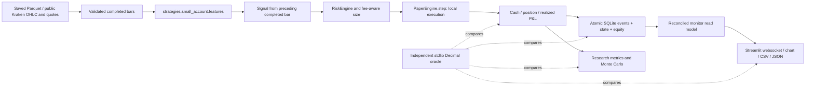

# Independent financial and end-to-end audit

Audit date: 30 September 2026. **The local £100 cash-account replay/paper path passes the tested numerical and lifecycle cases after repairs. The repository as a whole does not pass certification for unattended trading.** The separate legacy Alpaca adapter has a reproduced partial-fill accounting defect and incomplete reconciliation. No real-money orders were submitted. Live execution remains disabled in the £100 path.

This audit does not establish a profitable strategy. The repeated historical experiment still qualifies **zero candidates**. A successful software regression test, a synthetic profitable fixture, and an assumed Monte Carlo win rate are not evidence of future returns.

## System and dependency map

The repository contains several execution systems, not one universal accounting engine. The generated inventory, `results/qa_audit_20260930/dependency_inventory.json`, records Python modules, imports, functions, line counts and source hashes. The prior architectural survey is in [small-account-architecture.md](small-account-architecture.md). All pre-existing uncommitted work was preserved.



The legacy path is: catalog → Nautilus strategies → Nautilus risk/portfolio/cache → BacktestEngine or TradingNode → simulated execution or Alpaca paper adapter → equity history → research metrics/Streamlit. Other research finders use separate vectorized simulators. Passing tests for the £100 path do not certify all those implementations.

| Quantity | Source of truth for the audited local path |
|---|---|
| Cash | Initial £100 plus ENTRY/EXIT cash flows; independently reconciled with state and latest SQLite snapshot |
| Position quantity, entry and cost basis | Execution journal, compared with state; one long position, all entry fees included in basis |
| Realized P&L | Closed execution proceeds less entry cost including both commissions |
| Realized balance | £100 + net realized P&L; not available cash |
| Unrealized P&L | Marked position value less fee-inclusive remaining basis; zero when flat |
| Equity | Cash + quantity × latest observed close/mid; does not deduct hypothetical liquidation costs |
| Fees | Sum of actual simulated ENTRY/EXIT commissions; spread/slippage are embedded in fills |
| Exposure | Marked notional / equity; no margin or leveraged positions supported |
| Remaining risk | Loss from current marked equity to adverse stop liquidation, including exit fee and friction; gaps can exceed it |
| Trade history | SQLite event journal, committed with state and equity in the same transaction |
| UI/API | Read-only `load_monitor`, then Streamlit websocket serialization; there is no separate financial REST API |

SQLite is checked on restart and before/after each step. Corrupted cash, position basis, realized history, unmatched exits, or a mismatched latest snapshot fail closed. A read transaction prevents the dashboard mixing state from different commits. This is consistency checking, not cryptographic tamper-proof storage: coherent alteration of every record is outside its protection.

## Environment, oracle and tolerances

Python 3.14.5, project `.venv`, SQLite WAL/FULL, pandas/NumPy/SciPy, Streamlit and Playwright with isolated system Google Chrome. Tests ran on local loopback. No user browser profile, broker credentials, private broker endpoint, or real funds were used.

`tests/financial_oracle.py` imports **only Python's standard library**. It uses Decimal cash flows, independent weighted-average cost accounting, explicit rolling-window indicator loops, sample statistics, a binomial sum and an absorbing-state probability calculation. Production functions are imported by tests only as the system under test, never by the oracle. SciPy sample standard deviation supplies an additional cross-check.

- Economic assertions: absolute £1e-8, well below one penny; no loose relative tolerance for balances. The production simulator stores binary floats, while the oracle retains Decimal values. This is not a claim of exchange-grade fixed-point settlement.
- Indicator values: generally absolute 1e-11 or 1e-12; normalized statistics compared at explicitly stated test tolerances.
- Display: exact formatted penny/percentage strings. Sub-penny fees remain unrounded internally; displayed values use Python formatting. The simulator does not claim a broker's minimum-commission or settlement rounding policy.
- Monte Carlo: exact count/number of paths for sampled outputs; analytic-probability checks use six binomial standard errors plus one path of discretization. A fixed seed is used. Convergence is not required to be monotonic.
- Exact analytical tails: inclusive thresholds with a bounded ULP correction for logarithmic floating-point rounding.

The oracle's £50 purchase/£60 sale example returns £109.80 after £0.10 entry and exit fees. Its partial-fill example gives £10.05 weighted average. Those examples test the oracle itself; the production engine is tested with its actual capped sizes, rather than bypassing risk limits to force arbitrary quantities.

## Permanent golden scenario and numerical verification

`tests/fixtures/financial_golden.json` contains 30 trades, 60 observed bars, 20 target exits, 10 stop exits, independent expected per-trade quantities, fills, cash balances, a 120-entry cash-flow ledger and an equity curve. Costs are 10bp commission per side, a 2bp full spread and 3bp adverse slippage per side. Trades are separated by 12 calendar days. This artificial fixture tests arithmetic, not strategy profitability.

| Metric | Independent expected value | Production result | Result |
|---|---:|---:|---|
| Final cash/equity | £112.41019096216144 | £112.41019096216152 | PASS |
| Net realized P&L | £12.41019096216144 | £12.41019096216156 | PASS |
| Gross trading P&L before commissions | £13.84434119856 | Net P&L + £1.43415023639856 | PASS |
| Commission | £1.43415023639856 | £1.43415023639856 | PASS |
| Closed trades | 30 | 30 | PASS |
| Win rate | 66.6666666667% | 66.6666666667% | PASS |
| Profit factor, net trade outcomes | 3.33384986846938 | Same within 1e-8 | PASS |
| Expectancy | £0.413673032072048 | Same within 1e-8 | PASS |
| Maximum marked-equity drawdown | 0.531140579846867% | Same within 1e-8 | PASS |
| Sharpe, 252 per observed-return convention | 6.16897635507828 | Same within 1e-8 | PASS |
| Sortino, downside RMS over all observations | 16.1821836112934 | Same within 1e-8 | PASS |

The last two numbers deliberately use the engine's documented observation-frequency convention. The fixture is sparse and is **not a daily strategy**; interpreting those annualized figures as investable performance would be wrong. The research output now explicitly labels annualization as per observed return, not elapsed-calendar CAGR. Arbitrarily irregular observations need a separately defined calendar-return series before investment interpretation.

The full expected/actual/difference tables are in `original_claims.csv`, `original_ledger.csv`, `golden_trades.csv`, `golden_ledger.csv`, and `browser/reconciliation.csv` under the audit result directory. At each production step, cash, equity and fees are reconciled. New-process restart recovers 30 closed trades and the final account value without duplicating execution.

## Backtest and strategy verification

All six small-account families were compared period by period with independent rolling-window calculations: Donchian, moving-average cross, RSI reversal, Bollinger reversion, volume breakout and gap continuation. ATR is a simple 14-bar true-range mean, RSI here is a simple rolling-gain/loss ratio, and Bollinger standard deviation is sample ddof=1. These are explicit implementation conventions, not claims of Wilder smoothing.

Prefix truncation at several cutoffs produces identical historical features and signals. Signal timestamps precede execution timestamps. The same bars replayed through `replay` and direct persisted `PaperEngine.step` produce identical state and journals. Separate independent cash flows reconstruct the exits.

Execution tests cover adverse buy/sell friction, commissions on winners and losers, partial IOC entry fills, rejection without cash mutation, conservative stop-first OHLC collisions, entry-bar stops, gap-through stops, scheduled exits at the open, prior-completed-bar trailing stops, extreme gaps, and final position closure. A scheduled open exit cannot consult later intrabar extremes. A completed previous candle's trailing stop becomes active before the next bar's stop checks.

The engine has no order book, queue-priority model, exchange-side stop, or latency-dependent intrabar fill model. Stop-first OHLC is conservative ambiguity handling, not reconstruction of an actual intrabar path. A fresh public REST quote also lacks an exchange-generated quote timestamp; response age does not prove market-event freshness.

The entire 144-candidate experiment was rerun from the **same eight saved Parquet snapshots**, without downloading replacement history. Training, three validation subwindows and later diagnostic ranges remain chronological; all candidates and neighboring periods 18/20/22 remain recorded. The data was already researched, so the last quarter is still a diagnostic sample, not genuinely unseen OOS.

| Selected historical diagnostic | Recalculated |
|---|---:|
| Candidate | XLE_bollinger_20 |
| Observation count | 366 |
| Closed trades | 8 |
| Final equity | £100.01880867069760 |
| Total return | 0.01880867069759% |
| Net expectancy/trade | £0.00235108383720 |
| Fees | £0.28132131763014 |
| Sharpe | 0.01776958564353 |
| Maximum drawdown | 1.49251010186182% |
| Profit factor | 1.01260203912464 |
| Qualified candidates | **0** |

All 17 originally reported headline metrics were independently recomputed from archived curves/trades and passed their stated conventions. Repairs change some execution cases and research variants; the original report is preserved, not silently overwritten. Use `results/qa_audit_20260930/corrected_research/` for current-source replay. The selected candidate's final equity differs from the old output only at floating-point noise level. That does not make its sparse evidence adequate.

Legacy signal-library EMA, MACD and session VWAP were independently checked. Its monotonic-gain RSI and CCI calculation were repaired. Legacy ML cross-validation incorrectly purged rows instead of daily sessions when multiple assets shared dates; it now groups sessions and preserves a session-based embargo. Previous outputs dependent on these indicators or that splitter require regeneration. Session-based purging assumes a common daily session horizon; irregular per-asset labels still require explicit label-end timestamps and are not certified by this fix.

## Monte Carlo verification

All **61 archived scenarios / 6,100,000 paths** reproduced their saved horizon summaries exactly. These include the stressed scenarios. Separately, 342 IID first-horizon target-hit probabilities were compared with an independent absorbing-state calculation; terminal probabilities were checked with an independent binomial sum. Every comparison passed its sampling bound.

A separate seeded test reconstructs individual sampled paths with Decimal, then checks terminal outcomes, running maxima, troughs, quantiles, drawdown events and all target counts. Nonzero circular-block paths are reconstructed independently. A zero-return bootstrap runs 100,000 paths through every horizon and remains exactly £100. Fixed seeds reproduce results; random seeds now store their actual generated value, making them replayable.

For p=45%, reward=2R, risk=10%, cost=0.1R, 21 opportunities, the exact probability of ever reaching £200 is **40.9148708585%**. Seeded runs gave 41.71% at 10,000 paths, 40.976% at 50,000 and 41.094% at 100,000. These are hypothetical assumptions, not an estimated tradable edge.

Ruin definitions remain distinct: exact zero, below £1 operational failure, loss relative to initial capital, and drawdown relative to a running peak. Bounded fractional IID losses generally cannot reach exact zero. Stress can wipe out capital through an oversized loss. Counterparty default and unknown real-world risks are not modeled. Zero observed events in 100,000 paths has a one-sided 95% upper bound of approximately 0.0029957%, conditional on the model.

Expected-log-growth and Kelly fields are now explicitly labeled **unstressed IID analytical quantities**, including when displayed alongside stressed simulations. They must not be mistaken for expectations under the stressed process.

The target mathematics independently verifies 10× wealth = **900% total return**, approximately **7.97751623% compounded per calendar day for 30 days**, or **11.58839925% per session for 21 sessions**. None of these requirements changes order risk.

## Risk, failures and persistence

The live-capable API is absent from the £100 engine. Every supported entry goes through deterministic `RiskEngine.approve`; exits pass reduce-only validation. Default state is PAPER with no qualified edge. `TRADING_MODE=LIVE` is rejected even if `LIVE_TRADING_CONFIRMED=true`. Environment/file kill switches block new entries and permit valid reductions.

Tests cover risk fractions 0.25%, 0.5%, 1%, fees and adverse exit costs, minimum notional, quantity steps, available cash, total/correlated exposure, daily/weekly loss, drawdown halt, losing-streak reduction, unavailable risk engine, stale data, clock skew, feed disconnection, unknown order status and inconsistent account state. 2%, 5% and 10% execution risk are rejected by the supported account limits. They remain analytical Monte Carlo inputs only.

Duplicate or old events do not execute twice. Two stale writers cannot both spend the same account: the second is rejected inside an immediate SQLite transaction. A failed database write rolls back in-memory state and database effects. Rejection does not create a position. Partial entry fills book only the filled quantity, cancel the remainder, and retain both-sided fee accounting. New-process restart and mid-position restoration are tested.

Shorting, leverage, liquidation, funding, overnight borrowing, multi-currency conversion, scaling entries, partial exits, and simultaneous multi-asset positions are **not supported by this local engine**. They are not silently approximated and receive no passing financial certification here. It uses percentage commissions, not fixed/minimum/maker/taker schedules. Synthetic oracle examples for average-cost scaling do not imply production support.

Property-style randomized tests cover 250 cost/slippage monotonicity cases. Fuzz cases reject nonfinite/negative OHLC, bad quotes, bad scenario configurations and unsupported sizing configurations. UTC events across UK DST fallback remain distinct. Data validation rejects duplicates/invalid OHLC and sorts historical out-of-order input; streaming old events are rejected.

## Browser, read model, exports and public-feed exercise

Playwright starts an isolated local Streamlit server and real headless Chrome. It verifies all eight metric strings against the oracle, downloads account JSON, journal CSV and equity CSV, and checks their values. The browser remains open while simulated entry and exit steps update the SQLite account; subsequent displays are checked against independently calculated open and closed balances.

After the golden scenario, the UI displays £112.41 cash/equity, £12.41 realized P&L, £0.00 unrealized P&L and £1.43 commission. On the next open fixture position, the independent reconciliation gives approximately £87.25270969 available cash, £112.62623269 equity and £0.21604173 unrealized P&L. The realized balance remains £112.41019096. After the exit, unrealized P&L returns to exactly displayed £0.00.

Every serialized equity chart point and timestamp is checked through Streamlit's Arrow chart dataset. Milestone progress uses `(equity − 100)/(target − 100)`, clamped to [0,1]. The daily rolling-window test includes the observation exactly on its boundary. Screenshots, downloaded files and the Playwright trace are retained in `results/qa_audit_20260930/browser/`.

There is no REST financial API to audit. “API reconciliation” in the verdict means the application read model and its websocket/export presentation, not an invented REST or external broker API guarantee.

A real public Kraken BTC/GBP feed was fetched and passed through the paper entry point. Feed status was OK, signal false, action HOLD, cash/equity £100 and no external orders. This validates the actual public-feed connection; it is **not** a claim of a live-data fill or a sustained forward paper record. Executed trades came from deterministic replay fixtures.

## Defects and repairs

| Severity | Reproduction / root cause | Repair |
|---|---|---|
| HIGH | Prior-candle trailing stop installed after checking the next bar | Activate before next-bar trigger checks |
| HIGH | Time exit used a later high/low before an exit scheduled at open | Resolve scheduled open exit before intrabar checks |
| HIGH | 100 × 1.0004 produced a stop microscopically below an exact 98.04 touch | Decimal entry-friction arithmetic; golden exact-touch regression |
| HIGH | Restart accepted cash/equity altered by £1; history not restored for metrics | Reconcile journal/state/snapshot; restore journal and curve |
| HIGH | Remaining risk excluded adverse exit spread, slippage and fee | Include estimated stop-liquidation costs |
| MEDIUM | A zero-P&L trade made mean loss −£5 instead of −£10 | Strictly negative losses; break-even remains nonwinning in win rate |
| MEDIUM | Dashboard dropped first return and used sqrt(365) for equities | Preserve initial £100 return; explicit 252/365 convention |
| MEDIUM | Progress used equity/target; exact rolling cutoff was excluded | Growth-based progress and inclusive trailing cutoff |
| MEDIUM | Monotonic positive RSI returned NaN | Correct zero-loss/flat boundaries |
| HIGH | CCI used deviations around different historical means | Mean absolute deviation around each current window's mean |
| CRITICAL | Multi-asset CV removed 7 rows instead of 7 sessions | Group dates; purge/embargo whole observed sessions |
| HIGH | Legacy order helper silently truncated 1.7 units to 1 | Reject fractional/invalid quantities before adapter submission |
| MEDIUM | Infinite MC cost accepted; random seed not recoverable | Finite/configuration checks; persisted effective seed |
| MEDIUM | Exact binomial tail excluded an all-wins target due to ceil roundoff | Inclusive ULP-bounded boundary handling |
| LOW | Flat account displayed £-0.00 unrealized P&L | Derive unrealized from actual open basis; zero when flat |
| MEDIUM | Dashboard could read different SQLite commits in separate SELECTs | Consistent read transaction and ledger reconciliation |

Additional hardening validates setup integer fields and venue quote/minimum metadata, avoids rounding a full fill down for a second time, annualizes crypto indicator volatility with 365, labels analytical stress fields, and exposes separate realized/unrealized balances and account/curve exports.

The before-repair failure logs are retained as `before_tests.txt`, `before_secondary.txt`, `before_legacy.txt`, `before_exact_tail.txt` and `browser_tests.txt`. A test-fixture expectation initially omitted the legacy CCI's documented clipping; that test was corrected to compare both clipped and unsaturated values. That was a test correction, not a production defect.

## Open failures and limitations

1. **HIGH, reproduced:** the legacy Alpaca handler ignores a `partially_filled` update. The regression calls the actual method, not a copied dispatcher. It is marked strict expected-failure, so it remains visible and an eventual fix must update the test. Correct incremental fills require cumulative-quantity/notional reconciliation, cancellation/rejection events and durable restart state. This audit does not substitute an untested broker redesign.
2. **CRITICAL deployment limitation:** legacy Alpaca account startup publishes a configured balance before verified broker reconciliation; status-report methods are stubs, and polling by submission time can miss later updates. Its real-money guard remains in place. Do not use this adapter for the £100 experiment.
3. **HIGH model limitation:** legacy daily Nautilus research intentionally uses same-bar-close fills from close-derived signals. The parity tests show its simulator agrees with itself; they do not prove an achievable market fill. It does not receive the local path's no-look-ahead/execution verdict.
4. No independent proof covers every arithmetic branch of every vectorized/GPU/ML research module. Repository inventory and passing legacy tests are not such a proof. Previously generated legacy CCI/RSI/CV results are invalidated pending regeneration.
5. The local model is cash-only, single-position and partly floating-point. It does not certify real broker settlement rounding, external order retry reconciliation, exchange failures, FX, funding, liquidation or portfolio correlation across multiple assets.
6. The paper evidence is one successful public-feed observation plus deterministic executed fixtures, not weeks of forward observations. There is no real-money deployment justification.
7. Risk-at-stop is not a guarantee: gaps, adverse prices, missing data and a halt that cannot reach a venue can exceed it. No live venue protective order is placed by this local simulator.
8. The benchmark does not certify high-frequency operation. 10,000 durable no-signal SQLite events took about 34.65 seconds; mean 3.47ms, p95 10.26ms, maximum 128.34ms on this machine under concurrent work. The model is intended for slow observations. A 100Hz hard-deadline requirement would fail this evidence; multi-instrument stress is unverified.

## Reproduction and files changed

Run from the repository root:

```bash
.venv/bin/pytest -q
.venv/bin/python scripts/verify_financial_audit.py
.venv/bin/python scripts/verify_monte_carlo_audit.py
.venv/bin/python scripts/benchmark_financial_audit.py
.venv/bin/python examples/replay_small_account.py --directory results/qa_audit_20260930/corrected_research
.venv/bin/python examples/paper_small_account.py --once --database results/qa_audit_20260930/live_public/paper.sqlite
.venv/bin/streamlit run dashboard/small_account_app.py
```

In the monitor, select `results/qa_audit_20260930/golden` for the synthetic account or `results/qa_audit_20260930/corrected_research` for the corrected historical output. Neither should be described as forward returns. The public-feed journal is at `results/qa_audit_20260930/live_public`. All generated artifacts remain under ignored `results/`; permanent tests, golden JSON, scripts and this report are repository files.

Added: `tests/financial_oracle.py`, `tests/test_financial_audit.py`, `tests/fixtures/financial_golden.json`, `tests/e2e/test_financial_browser.py`, `livesim/small_account_accounting.py`, and the three audit scripts above.

Modified for verified defects/hardening: `livesim/small_account.py`, `livesim/alpaca_exec_client.py`, `strategies/small_account.py`, `analysis/small_account_research.py`, `analysis/small_account_mc.py`, `analysis/small_account_monitor.py`, `analysis/signal_library.py`, `analysis/metrics.py` (convention documentation), `models/cv.py`, `data/small_account_feed.py`, `examples/paper_small_account.py`, `dashboard/views/small_account.py`, `tests/test_small_account_dashboard.py`, and the existing discovery-browser fixture's system-Chrome fallback. Documentation notices identify invalidated old artifacts. No strategy family or selection objective was redesigned.

## Final regression result

The final full suite completed with **465 passed, 1 strict expected failure, 5 warnings in 87.74 seconds**. This includes actual Chrome browser tests. The expected failure is the reproduced, unresolved legacy Alpaca partial-fill defect; it is **not a PASS** and is the reason the wider repository verdict fails. Warnings are one upstream websockets deprecation and four NumPy warnings in existing synthetic Quantstats tearsheet tests.

The current-source frozen-selection CLI also completed successfully: `verified=true`, XLE_bollinger_20, eight closed trades, £100.01880867069760. Research and Monte Carlo runs are separate from the pytest total. The secret-history heuristic scanned 226 reachable blobs, found no matching credentials, and skipped no large blobs; unknown secret formats and unreachable history remain outside that check.

## Verification matrix

**Scope of PASS: the repaired local £100 cash-account engine, its six deterministic rule families, saved-data replay, SQLite read model and monitor, under the tested execution assumptions. FAIL means the wider claim cannot be certified.** Unsupported features are explicitly listed above; a PASS does not imply their existence.

| Required verdict | Local audited path | Repository-wide qualification |
|---|---|---|
| Accounting correct | PASS | FAIL — legacy partial fills unreconciled |
| P&L correct | PASS | FAIL — external partial executions unaccounted |
| Fees correct | PASS — supported percentage model | FAIL — other venue schedules unverified |
| Position sizing correct | PASS — capped long cash account | FAIL — no universal certification |
| Risk limits correct | PASS — supported entry boundary | FAIL — legacy startup/reconciliation gaps |
| Indicators correct | PASS — independent covered calculations | FAIL — all research variants not independently proven |
| Signals correct | PASS — six local families | FAIL — all legacy/ML strategies not independently proven |
| No look-ahead detected | PASS — causal local prefixes and next event | FAIL — legacy close-fill interpretation |
| Backtest execution realistic | PASS — stated conservative OHLC model | FAIL — legacy same-close and no venue microstructure proof |
| Performance statistics correct | PASS — documented frequency conventions | FAIL — no universal cross-module equivalence |
| Monte Carlo correct | PASS — sampled/analytical cases and reproduced scenarios | PASS — covered small-account MC engine only |
| Database reconciliation | PASS | FAIL — external adapter recovery unimplemented |
| API reconciliation | PASS — local read model/export boundary | FAIL — external broker API not certified |
| UI reconciliation | PASS — eight metrics, chart points and exports | FAIL — every legacy screen not numerically audited |
| Paper trading E2E | PASS — deterministic execution + separate real feed HOLD | FAIL — sustained broker-connected execution unverified |
| Restart/recovery | PASS — SQLite and new process | FAIL — legacy adapter reconciliation stubs |
| Safe for paper trading | PASS — local isolated research scope | **FAIL — unrestricted repository-wide use** |

**Software conclusion:** the repaired local path is internally consistent for the tested supported scope. **Trading conclusion:** insufficient forward evidence and zero qualified candidates; no real-money deployment endorsement.
