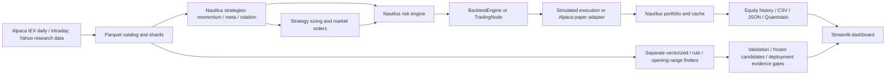
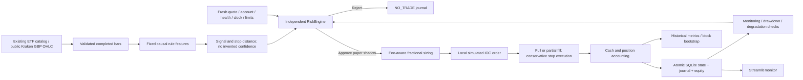

# £100 architecture and repository audit

Audit date: 2026-09-30. Repository-wide AST inventory covered the original 172 Python files / 25,073 lines; key execution, research, model and dashboard paths were inspected directly. This is an architecture and targeted correctness audit, not a formal proof of every line. Inventory: `results/small_account/repository_inventory.json`. Existing uncommitted user work was preserved.

## Existing architecture

| Area | Existing implementation and audit finding |
|---|---|
| Language/environment | Python 3.12–3.14; inspected interpreter 3.14.5; uv; pinned Nautilus and Alpaca; pandas/NumPy, LightGBM, Torch, Streamlit. |
| Data | `data/alpaca_client.py`, ingestion scripts, instrument/bar converters, `multitf.py`; catalog and per-symbol Parquet. IEX is venue-limited, not consolidated NBBO. Yahoo is explicitly research-only. |
| Strategies | Monthly top-N sector momentum; meta-model filtering/sizing; serialized rotation rules; newer large intraday discovery families. |
| Backtesting | Nautilus engine plus pure simulators and CPU/GPU screens. Old daily simulation explicitly fills same-bar close; the new path instead waits for a subsequent observed open. |
| Portfolio/sizing | Legacy momentum uses whole shares and relatively large balances. These assumptions do not transfer to £100. |
| Risk | Nautilus order checks plus separate profitability deployment guards. The profitability guard is not a universal interceptor for legacy strategies. Replay node uses a deliberately very high submission-rate ceiling. |
| Paper/live | Legacy `AlpacaLiveExecutionClient` enforces `paper=True`. Initial published balance defaults to $100,000; audited connect path does not reconcile real balance before permitting submissions. Partial fills are deferred, rejected/cancelled orders only logged; timestamp-based polling can miss later updates of older submitted orders. Restart reconciliation is disabled in node configuration. Do not use it for this experiment or remove its live prohibition. |
| Storage | Catalog/results in Parquet/CSV/JSON; model snapshots in dated joblib; Nautilus runtime cache in memory. Load joblib only from trusted local artifacts because it can execute code. |
| Statistics | Legacy DSR mixed annualized Sharpe with per-observation standard error, inflating confidence. Corrected unit conversion and tests; legacy reports invalidated by a README notice. The remaining Gaussian IID approximation cannot establish significance for median-of-window Sharpe statistics. |
| ML validation | `models/cv.py` subtracts row counts despite day-based names; multi-asset repeated dates need explicit date/label-end handling before reuse. Its splitter is not used by the new research path. No old ML result qualified this account. |
| Data integrity | SPY contained an isolated 2018 observation followed by a 634-day gap. New equity research intersects the six ETF session sets: 2020-07-27 through 2026-05-22, 1,464 sessions; no filling. |
| Dashboard | Existing chart, backtest, strategy-launcher, research-result, model, sentiment and journal views; new read-only £100 tab and standalone app reuse Streamlit. |
| Logging/notifications | Existing Nautilus/subprocess logs. New SQLite events, equity snapshots and JSON feed status; no external messaging configured or sent. |
| Configuration/deployment | Python dataclasses, CLI and environment variables. Local processes; no new remote deployment, service enablement or live credentials needed. |
| Secrets | `.env` ignored, `.env.example` blank credentials. Heuristic audit scanned 226 reachable historical blobs, no detected matches, no skipped large blobs. This cannot prove absence of unknown secret formats, unreachable history or external logs. |
| Tests | Original offline baseline: 323 passing tests. New failure, accounting, data, dashboard and replay checks are recorded in the research report. |

## Added cash-account path

All new entries go through `RiskEngine.approve` immediately before local execution. Exits pass the independent reduce-only validator, which rejects invalid quantities and prevents crossing into a short position; entry kill switches do not trap existing positions. No authenticated broker API or real-money order method exists on this path. Current configuration supports one long, cash-funded position; correlated and total exposure therefore coincide. Unsupported leverage, shorting and multi-position portfolios are rejected instead of approximated.

`PaperEngine.step` is shared by historical replay and forward quote paper execution. Historical replay uses previous completed signals, subsequent opens and stop-first OHLC ambiguity. Forward paper uses only fresh observed quotes, never retroactive completed-bar prices. Historical and forward fills are different observations of the same accounting/risk code, not claims of exact live-fill parity.

SQLite uses an immediate write transaction, WAL and full synchronization. State, events and equity commit together. Duplicate/old event timestamps are ignored; signal IDs prevent reentry on the same signal. A second stale process fails the persisted-state consistency check. Failed writes roll back state and events. Changed configuration cannot silently reuse an old ledger.

The simulator supports partial IOC fills, cancels the remainder and books only executed quantities. This tests accounting; it is not a tested external broker reconciliation adapter. Unknown external order state blocks new entries. A future real adapter needs durable client IDs, incremental fill reconciliation, rejection/cancellation events, balance checks and restart recovery before connection to capital.

## Files and boundaries

- `analysis/small_account_{research,mc,costs,monitor}.py`: experiments, metrics, scenarios, cost arithmetic and rolling monitoring.
- `strategies/small_account.py`: six deterministic signal families and four stop variants.
- `livesim/small_account_risk.py`: independent caps and fee-aware sizing; `livesim/small_account.py`: shared simulation/paper state machine.
- `data/small_account_feed.py`: public Kraken GBP candles/quotes and venue minima; no credentials.
- `examples/{research,paper,replay}_small_account.py`: runnable entry points.
- `dashboard/views/small_account.py`, `dashboard/small_account_app.py`: monitoring; `dashboard/app.py` adds a tab.
- `scripts/audit_secret_history.py`: read-only redacted history scan.
- `tests/test_small_account*.py`: risk, failure, accounting, data and UI tests.
- `analysis/deflated_sharpe.py`, its tests, README and `.env.example`: unit correction, invalidation notice and safety defaults.

Legacy research/backtesting remains available. Its broker adapter is explicitly not certified by the new tests. No API keys, account opening, subscription purchases, real orders or external communications were performed.
